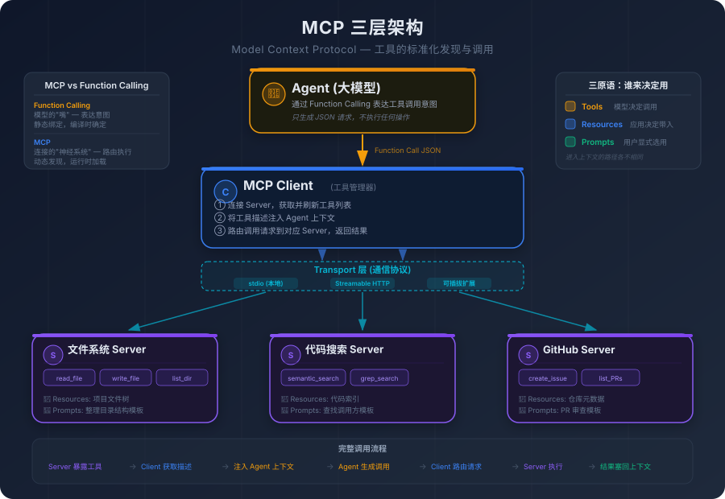
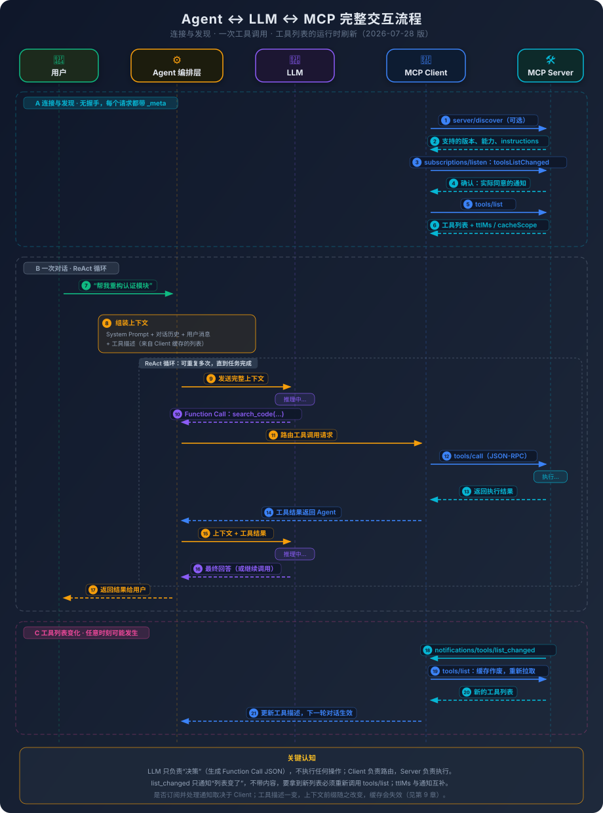
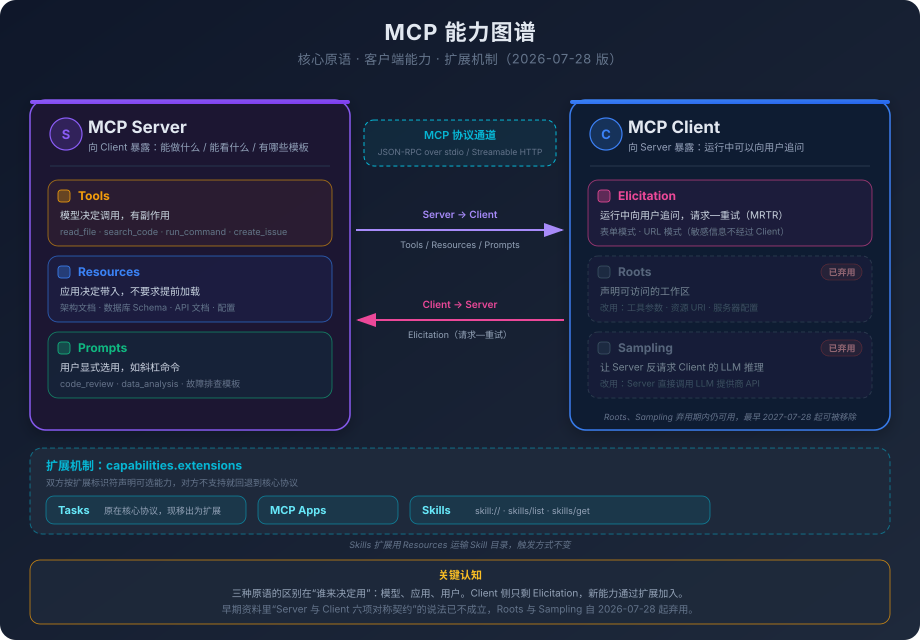

# 4. 工具的标准化：MCP 交互原理

你开发了一个数据库查询工具。它能连接 PostgreSQL，执行 SQL 查询，返回格式化的结果。你在自己的 AI 编程环境里用得很顺手，Agent 需要查数据的时候调用它，拿到结果继续分析。

然后你想把这个工具分享给团队。

你的同事 A 用 Cursor，同事 B 用 Copilot，同事 C 用 Codex。你打开三个平台的文档，发现它们定义工具的方式完全不同，参数格式不同、注册方式不同、返回值结构不同、错误处理约定不同。你要为同一个工具写三套适配代码。如果明天又来了一个新平台，你就要写第四套。

这个场景是不是很眼熟？

如果你经历过 Web 开发的早期年代，你一定记得浏览器兼容性的噩梦：同一段 JavaScript，在 IE 里要这样写，在 Firefox 里要那样写，在 Safari 里又是另一种写法。那个时代的 Web 开发者花了大量时间在"适配"上，而不是在"开发"上。直到 Web 标准逐渐统一，这个问题才被根本性地解决。

在 MCP 出现之前，AI 工具调用领域就处在同样的阶段。每个平台都在造自己的轮子，工具开发者被迫为每个轮子做适配。这不是一个"不方便"的问题，而是一个阻碍整个生态发展的结构性障碍。

## 4.1 工具集成的困境：碎片化的代价

Agent 能"做事"的前提是有工具可用。但在真实的工程环境中，工具的集成远比想象中复杂。本节写的是标准化之前的局面。

在最简单的场景下，工具是硬编码在 Agent 的 System Prompt 里的。你在提示词中写："你可以调用以下函数：`read_file(path)`、`search_code(query)`、`run_command(cmd)`。"模型看到这些描述，在需要的时候生成对应的 JSON 调用请求。外部系统解析 JSON，执行操作，返回结果。

这种方式在工具数量少、使用场景固定的时候完全够用。但当你开始面对真实的工程环境，问题就一个接一个地冒出来了。

**工具数量的膨胀。** 一个真实的 AI 编程环境需要多少工具？文件读写、代码搜索、终端命令执行、Git 操作、数据库查询、API 调用、文档检索、测试运行、Lint 检查、依赖管理……轻轻松松就能列出几十个。如果再加上团队内部的自定义工具，内部 API 的封装、特定业务逻辑的查询、CI/CD 流水线的触发——数量可以轻松突破一百。

把一百个工具的描述全部塞进 System Prompt？每个工具的描述按 100 Token 算，一百个工具就是一万 Token，还没开始干活，上下文窗口就被工具描述吃掉了一大块。而且模型面对一百个工具的选择空间，做出正确选择的概率也会显著下降。

**工具的来源多样化。** 在一个团队里，工具的来源不是单一的。有些工具是 IDE 内置的（文件操作、终端命令），有些是第三方服务的封装（GitHub API、Jira API），有些是团队自己开发的（内部知识库查询、业务数据分析）。这些工具的开发者不同、维护节奏不同、接口风格不同。如果每个工具都要手动集成到 Agent 的配置里，维护成本会随工具数量线性增长。

**跨平台的适配成本。** 这是最直接的痛点。各家模型厂商的函数调用接口描述工具的格式各不相同，各种开源 Agent 框架又各有一套。如果你开发了一个有价值的工具，比如一个能分析代码复杂度的工具。你想让所有 AI 编程平台都能用它，就必须为每个平台写一套适配层。这不是技术上做不到，而是成本太高、维护太累。

但问题的根源比格式不统一更深。

**缺乏标准化的工具发现机制。** 格式不统一只是表面问题。更深层的问题是：Agent 怎么知道有哪些工具可用？在硬编码模式下，答案是开发者在配置文件里写死。但如果工具是动态的呢？如果一个新的工具提供方上线了，提供了一组新的工具，Agent 能不能自动发现它们？在没有标准化发现机制的情况下，每次新增工具都需要人工介入：修改配置、重启 Agent、验证集成。

**缺乏标准化的能力描述方式。** 不同平台对工具能做什么的描述方式不同。有的用自然语言，有的用 JSON Schema，有的用自定义的 DSL。Agent 对工具的理解完全来自这些描述。如果描述方式不统一，同一个工具在不同平台上的表现就可能完全不同。

**缺乏标准化的权限模型。** 工具调用涉及安全问题。一个能执行终端命令的工具，权限边界在哪里？它能执行 `rm -rf /` 吗？谁来定义这个边界？在没有标准化权限模型的情况下，每个平台各自实现自己的安全策略，工具开发者无法做出跨平台一致的安全承诺。

如果你做过微服务架构，这些问题应该不陌生。微服务早期也经历过类似的阶段：每个服务用自己的通信协议、自己的服务发现方式、自己的认证机制。直到 gRPC、Consul、OAuth 这些标准化方案出现，微服务生态才真正成熟起来。

AI 工具调用需要同样的标准化，这就是 MCP 的出发点。

## 4.2 从静态绑定到动态发现：MCP 的设计动机

让我们从 Function Calling 的局限性出发，一步步推导出 MCP 要解决的问题。

按最常见的用法，Function Calling 是**静态绑定**：在对话开始之前，你就把所有可用工具的描述写进了配置或 System Prompt。模型在整个对话过程中，能用的工具就是这些，不多也不少。这就像编译型语言中的静态链接。所有依赖在编译时就确定了，运行时不能改变。

静态绑定在简单场景下工作得很好。但当你面对以下需求时，它就撑不住了：

**不同的任务需要不同的工具集。** 你让 Agent 写代码的时候，它需要文件操作和代码搜索工具。你让它分析数据的时候，它需要数据库查询和可视化工具。你让它管理项目的时候，它需要 Jira 和 GitHub 的 API。如果把所有工具都塞进 System Prompt，大部分工具在大部分时候都是无用的，它们白白占用上下文空间，还增加了模型选错工具的概率。

**工具的提供者和 Agent 的开发者不是同一个人。** 你的团队开发了一个内部知识库查询工具，想让所有人的 AI 编程环境都能用。在静态绑定模式下，每个人都要手动把这个工具的描述添加到自己的配置里。工具更新了接口？每个人都要手动更新配置。工具下线了？每个人都要手动删除配置。这个维护成本随团队规模线性增长。

**可用的工具会随环境变化。** 项目换了语言，连上了新的数据库，某个服务下线了，能用的工具也该跟着变。静态绑定下，这些变化只能靠人改配置、重开对话。

你需要的是**动态发现**：Agent 在运行时能够发现有哪些工具可用，获取它们的描述，按需调用。这就像微服务架构中的服务发现，服务消费者不需要硬编码服务提供者的地址，而是通过注册中心动态获取。

MCP（Model Context Protocol）[1]就是 AI 工具调用领域的"服务发现 + 通信协议"。它的核心设计目标只有一个：**让工具的提供和使用解耦。**

工具开发者按照 MCP 协议暴露自己的能力：我能做什么、怎么调用我、参数是什么。Agent 按照 MCP 协议发现和调用工具：有谁能做什么、我怎么把请求送过去、结果怎么拿回来。两者不需要知道对方的实现细节，只需要遵守同一套协议。

MCP 之于 Agent，就像 API Gateway 之于微服务，它不做具体的事，但它定义了怎么找到能做事的人和怎么把请求转过去。

## 4.3 MCP 的三层架构：Server、Client、Transport

MCP 的架构设计围绕三个角色展开：Server、Client 和 Transport。

**MCP Server** 是工具的提供方。每个 Server 暴露一组工具（Tools），每个工具有名称、描述和参数 Schema。一个 Server 可以只提供一个工具，也可以提供一组相关的工具。比如，一个"文件系统 Server"可能提供 `read_file`、`write_file`、`list_directory` 三个工具；一个"GitHub Server"可能提供 `create_issue`、`list_pull_requests`、`get_commit_history` 等工具。

Server 的职责很明确：声明我能做什么，然后在被调用时真正去做。它不关心谁在调用它、为什么调用它、调用结果会被怎么使用。它只需要按照协议暴露接口、接收请求、返回结果。

**MCP Client** 是 Agent 侧的组件。它负责连接到一个或多个 Server，获取工具列表，在 Agent 需要调用工具时把请求转发给对应的 Server。

Client 的角色有点像一个工具管理器。它知道当前连接了哪些 Server，每个 Server 提供了哪些工具，每个工具的参数是什么。当 Agent 通过 Function Calling 机制决定调用某个工具时，Client 负责找到提供这个工具的 Server，把调用请求按照协议格式发送过去，等待结果，然后把结果返回给 Agent。

**Transport** 是通信层，负责 Client 和 Server 之间的消息传递。MCP 支持多种 Transport 方式：

- **stdio**：通过标准输入/输出进行通信。Server 作为一个本地进程运行，Client 通过 stdin/stdout 和它交换消息。这是最简单的方式，适合本地工具。
- **Streamable HTTP**：通过单一 HTTP 端点进行通信，按需升级为流式响应。Server 可以运行在远程机器上，Client 通过网络访问。适合远程工具和共享工具。早期版本的 MCP 把这套通信方式拆成 HTTP 请求 + 独立的 SSE 通道，后来合并成了一个端点的 Streamable HTTP，旧的拆分方式已被列为弃用[2]，新写的 Server 应当直接用 Streamable HTTP。

Transport 的设计是可插拔的，协议本身不绑定特定的通信方式。这使得同一个 Server 可以同时支持 stdio 和 HTTP，同一个 Client 可以同时连接本地 Server 和远程 Server。

把三个角色放进一次真实的运行里，整个过程可以分成三段，下图把它们画在了一起。后文提到的步骤编号，都指这张图。本书按 2026-07-28 版规范来讲[1]，这一版在连接方式上和更早的版本差别不小，差别放在本节末尾。

**A. 连接与发现。** 新版没有握手，每个请求都在 `_meta` 里带上协议版本、客户端信息和客户端能力，服务器对每个请求单独接受或拒绝，不存在会话。服务器必须实现 `server/discover`，客户端可以先调用它，了解服务器支持的协议版本和能力，以及写给模型看的使用说明 `instructions`（步骤 1、2）。版本对不上时，服务器返回错误并列出自己支持的版本，客户端挑一个重试。接着，Client 用 `subscriptions/listen` 打开一条通知流，声明想收到 `toolsListChanged`（步骤 3），Server 先回一条确认，说明它实际同意订阅哪些通知（步骤 4）。最后 Client 调用 `tools/list`（步骤 5），Server 返回每个工具的名称、描述和参数 Schema，同时附上缓存提示：`ttlMs` 表示这份列表在多少毫秒内可以当作新鲜的，`cacheScope` 表示它能否在不同用户或授权上下文之间共享（步骤 6）。

**B. 一次对话，也就是第 3 章的 ReAct 循环。** 用户提出请求（步骤 7）。Agent 编排层组装上下文：System Prompt、对话历史、用户消息，再加上 Client 缓存的工具描述。模型对工具的全部认识，就来自这几段描述（步骤 8）。完整上下文发给 LLM（步骤 9），模型决定调用工具时，输出一段 Function Calling 格式的 JSON（步骤 10）。LLM 到这里为止，它不执行任何操作。Agent 把这段意图交给 Client（步骤 11），Client 找到对应的 Server，用 `tools/call` 发出请求（步骤 12），Server 执行后返回结果（步骤 13），结果经 Client 回到 Agent（步骤 14），被塞回上下文，再发给 LLM（步骤 15）。LLM 要么继续调用工具，要么给出最终回答（步骤 16），任务完成后结果才交给用户（步骤 17）。

**C. 工具列表变化，任意时刻都可能发生。** 前两段是一次连接里的常规流程，"动态"靠的是第三段。工具列表变了，比如 Server 上线了一个新工具，或者撤掉了一个，只要它声明过 `listChanged`，就会通过步骤 3 打开的那条通知流，向订阅了 `toolsListChanged` 的 Client 推送一条 `notifications/tools/list_changed`（步骤 18）。这条通知只说"列表变了"，不带内容，也不说是增是减。Client 收到后把本地缓存作废，重新调用 `tools/list`（步骤 19、20），再更新交给 Agent 的工具描述，从下一轮组装上下文开始生效（步骤 21）。

通知和 `ttlMs` 是互补的两条路：`ttlMs` 告诉 Client 这份列表在多久之内不必再问，通知则在列表变化的那一刻让缓存作废。Server 甚至可以只给 `ttlMs`、不声明 `listChanged`，这时 Client 完全靠缓存过期来发现变化。

这套机制有几个边界，需要提前说清楚：

- 通知在规范里是 SHOULD，不是 MUST，而且只会发给打开了通知流、并声明了 `toolsListChanged` 的 Client。没订阅的 Client，只能等 `ttlMs` 到期后重新拉取。
- 协议提供了通道，用没用上要看具体的 Client。一个既不订阅、也不理会 TTL 的 Client，工具列表就停在第一次拉取时的样子，"动态"只剩下重连。
- 什么条件下该有哪些工具，协议不管，新版还加了一条限制：对同样的请求，Server 返回的工具集不能因连接不同而不同，只能因请求携带的授权不同而不同。所以"只在处理 Python 项目时才出现 Python 工具"这类需求，实际有两条路：由 Client 和用户决定连接哪些 Server，或者让不同授权看到不同的工具。
- 工具描述一变，上下文前缀跟着变，第 9 章讲的缓存会随之失效。规范也建议 Server 按确定的顺序返回工具，目的之一就是让 LLM 的 Prompt 缓存更容易命中。频繁换工具，并不是免费的。

如果你读的是旧资料，会发现流程不一样。2025-11-25 及更早的版本，连接时要先发 `initialize` 协商版本和能力，建立一条会话，工具列表变化的通知就走这条会话，没有 `subscriptions/listen` 这一步，也没有 `ttlMs` 和 `cacheScope`。存量的 Client 和 Server 不会一夜之间升级，新版规范因此定义了两边互相探测、回退到旧握手的规则[1]。两个版本里不变的是核心思路：先发现工具，把描述交给模型，模型生成调用意图，Client 路由，Server 执行，工具变了就通知 Client 重新拉取。

如果你把 MCP 的本质抽象出来，它就是一个 JSON-RPC 协议加上一套工具描述规范。JSON-RPC 负责消息的格式和传递，工具描述规范负责怎么告诉 Agent 这个工具能做什么。把它想成 OpenAPI Spec 的 AI 版本，就不神秘了。OpenAPI Spec 定义了怎么描述一个 REST API，MCP 定义了怎么描述一个 AI 可调用的工具。区别在于，OpenAPI 的消费者是人类开发者，MCP 的消费者是大模型。

这个区别看起来微小，但它引出了一个至关重要的问题。

## 4.4 工具描述的艺术：模型对工具的"理解"完全来自文本

OpenAPI Spec 写得差一点，人类开发者可以看源码、问同事、试着调一下看看返回什么。但 MCP 的工具描述写得差，模型没有任何补救手段，它对工具的全部理解，就是那段描述文本。

这是 MCP 生态中最容易被忽视、但影响最大的问题。

回忆第三章讲 Function Calling 时提到的：模型只通过工具的描述来理解工具的功能。描述中的每一个词，都会通过注意力机制影响模型的决策，什么时候调用这个工具、传什么参数、怎么解读返回结果。

我们来看一个具体的例子。假设你有一个代码搜索工具，以下是两种不同的描述方式：

**描述 A：**
> 名称：search_code
> 描述：搜索代码

**描述 B：**
> 名称：search_code
> 描述：在当前项目的源代码文件中进行语义搜索。输入一个自然语言查询，返回最相关的代码片段及其文件路径和行号。适用于需要理解代码含义的场景（如"找到处理用户认证的函数"）。如果需要精确的文本匹配（如查找某个变量名的所有出现位置），请使用 grep_search 工具。

同一个工具，描述 A 和描述 B 会导致模型做出完全不同的决策。

面对描述 A，模型只知道"这个工具能搜索代码"，但不知道它是语义搜索还是文本搜索、搜索范围是什么、返回格式是什么。模型可能在需要精确匹配的时候调用它（因为描述没说它不能做精确匹配），也可能在需要搜索文档的时候调用它（因为描述没说它只搜索代码）。

面对描述 B，模型知道这是语义搜索、知道搜索范围是源代码文件、知道返回格式包含文件路径和行号、知道什么时候该用它什么时候不该用它。模型做出正确决策的概率大幅提高。

工具描述的关键要素包括：

**名称**：简洁明确，让模型从名称就能大致判断工具的用途。`search_code` 比 `tool_1` 好，`semantic_code_search` 比 `search_code` 更精确。

**功能描述**：说清楚这个工具做什么、适用于什么场景、不适用于什么场景。不适用于什么往往比适用于什么更重要，它帮助模型在多个相似工具之间做出正确选择。

**参数 Schema**：每个参数的类型、含义、约束条件。不只是"path: string"，而是"path: string，文件的绝对路径，必须是项目目录下的文件，不支持通配符"。

**返回值说明**：返回什么格式的数据、可能的错误情况。模型需要知道返回值的结构，才能正确解读结果。

但这里有一点要警惕：**工具描述本身也占用上下文空间。**

每个工具的描述按 100-200 Token 算，50 个工具就是 5000-10000 Token。还没开始干活，上下文窗口就被工具描述吃掉了一大块。描述写得越详细，模型选择越准确，但占用的空间也越大，留给实际任务的空间就越少。

这是一个需要权衡的设计决策。描述太简略，模型不知道什么时候该用、怎么用；描述太详细，上下文空间被挤占。在实践中，一个有效的策略是"分层描述"：核心信息（名称、一句话功能说明、关键参数）放在工具描述里，详细的使用说明和示例放在工具的扩展文档里，只在模型明确需要时才加载。

工具描述的质量是 MCP 生态的关键因素。协议再标准、架构再优雅，如果工具描述写得差，Agent 的使用体验就差。这就像 REST API 的设计，HTTP 协议本身是标准的，但如果 API 的文档写得一塌糊涂，开发者照样用不好。MCP 定义了怎么描述工具的格式，但它不能保证描述的质量。质量取决于工具开发者对模型怎么理解文本的认知，而这个认知，恰恰是大多数工具开发者所缺乏的。

## 4.5 MCP 与 Function Calling 的本质区别

到这里，你可能会有一个疑问：MCP 和 Function Calling 是什么关系？MCP 是 Function Calling 的替代品吗？

不是。它们解决的是不同层次的问题。

**Function Calling 解决的是"模型怎么表达工具调用意图"。** 它是模型侧的能力，模型在生成过程中，能够输出一段结构化的 JSON 来表示"我想调用这个工具"。这个能力是通过训练获得的，是模型本身的一部分。没有 Function Calling，模型就只能输出自然语言文本，无法与外部工具交互。

**MCP 解决的是"工具怎么被发现、描述和调用"。** 它是系统侧的协议，定义了工具提供者和工具使用者之间的通信标准。没有 MCP，工具仍然可以被调用（通过硬编码的方式），但工具的发现、管理和跨平台复用就没有标准化的方案。

两者的关系不是替代，而是协作。回看 4.3 节的时序图：Function Calling 只负责步骤 10，也就是模型生成调用意图，它自己不执行任何操作。其余的发现、描述、路由、执行和列表刷新，都是 MCP 的事。它们在不同的层次上各司其职。

一个更精确的类比：Function Calling 是模型的嘴，它让模型能够表达我想做什么。MCP 是连接模型和工具的神经系统，它让模型的意图能够被正确地路由到对应的工具，并把结果传回来。嘴和神经系统分工不同，少了哪一个都不行。

理解了这个区别，你就能避免一个常见的混淆：有人说MCP 会取代 Function Calling，这是不对的。MCP 没有改变模型表达工具调用意图的方式，模型仍然是通过生成结构化的 JSON 来请求调用工具。MCP 改变的是这个请求被处理的方式，从硬编码在 Agent 配置里变成通过标准化协议动态路由。

还有一个区别值得强调：**静态绑定与动态发现。**

在静态绑定的用法下，工具列表在对话开始前就确定了，你在配置里写了 5 个工具，模型在整个对话过程中就只能用这 5 个。如果中途需要一个新工具，你只能结束对话、修改配置、重新开始。

在 MCP 模式下，工具列表在连接时获取，也能在运行中刷新。一个 Server 的工具变了，它推送 `list_changed` 通知，Client 作废缓存并重新拉取列表，Agent 从下一轮对话起就能用上新的工具，不需要重启，也不需要改配置。一个 Server 下线了，Client 断开连接，把它的工具从列表里移除。具体过程见 4.3 节第三段。前提是这个 Client 订阅并处理了通知，协议只提供通道，不保证每个 Client 都用上了它。

这种动态性是 MCP 相对于静态绑定的核心优势。它让工具的生命周期和 Agent 的生命周期解耦，工具可以独立地上线、更新、下线，Agent 不需要为此做任何改变。

再往深一层，还有一个区别值得提前点出来：**Function Calling 是单向的，MCP 留了一条反向通道。** Function Calling 里只有模型在表达意图，外部世界被动地执行；MCP 里，Server 在处理请求的途中可以停下来，向用户要一个它缺的信息，这叫 Elicitation。早期版本的 MCP 还设计过更多反向能力，比如让 Server 借用 Client 的模型做推理，但这些在最新版本里被收回了。这条反向通道留下了什么、收回了什么，下一节展开。

## 4.6 MCP 的能力图谱：从工具协议到上下文协议

到目前为止，我们一直在讲 MCP 的工具（Tools）。但 MCP 的能力不止于此。如果你只读过早期介绍 MCP 的文章，很容易把它理解成工具调用的标准化协议，这个理解放在今天已经偏窄了。另一种流行的说法，Server 和 Client 之间是一组对称的契约，放到最新版本也已经不成立，下面会看到原因。现在的 MCP 由三部分组成：Server 向 Client 暴露的三种核心原语，Client 向 Server 暴露的能力，以及让协议继续长出新能力的扩展机制。

先看 Server 这一侧。Server 向 Client 暴露三种经典原语，区分它们最有用的角度，是**谁来决定用它**：

| 原语 | 是什么 | 谁决定用 | 怎么交互 |
| :--- | :--- | :--- | :--- |
| Tools | 可执行的操作，有副作用 | 模型 | 模型生成调用意图，Client 用 `tools/call` 转发给 Server |
| Resources | 可读取的数据：文件、数据库 Schema、文档 | 应用 | Client 用 `resources/list` 发现，应用决定带哪些进上下文，再用 `resources/read` 读取 |
| Prompts | 带参数的提示词模板 | 用户 | Client 用 `prompts/list` 发现，用户在界面里显式选用，Client 用 `prompts/get` 带参数取回填好的消息 |

三者各自都有一条 `list_changed` 通知，订阅方式和 4.3 节第三段相同，只是在 `subscriptions/listen` 里分别声明 `promptsListChanged`、`resourcesListChanged`。

**Tools** 是前面一直在讨论的：模型在执行过程中判断自己需要什么，生成一次调用，Server 执行并返回结果。`read_file`、`search_code`、`run_command` 都是 Tools，它们会读取外部数据、修改外部状态，或者触发外部操作。

**Resources** 的决定权在应用。规范的说法是 application-driven：应用决定把哪些资源、以什么方式纳入上下文。可以让用户在界面里手动选，可以搜索过滤，也可以按规则自动带上，规范没有强制某一种做法。如果你有一份项目的架构文档，希望整个任务过程中都能参考，做成 Resource 更合适，由应用在任务开始时带进上下文。做成一个 `get_architecture_doc` 工具，模型可能在需要的时候忘了调用，或者在不需要的时候反复调用。

**Prompts** 的决定权在用户。Server 暴露的是一份份带参数的模板，比如一个 `code_review` Prompt，参数是要审查的代码。用户在 Client 的界面里选中它，规范举的例子是斜杠命令，Client 调用 `prompts/get` 并传入参数，Server 把参数填进模板，返回一组消息，这组消息进入对话，模型接着往下做。它不是 Agent 自己去读的"经验"，而是用户主动发起的一次带着模板的开场。

Resources 和 Prompts 的使用，都要求 Client 提供对应的界面：让用户挑资源，让用户选模板。各客户端的支持程度不一，用之前先确认你用的 Client 是否支持。

这两种原语承载的都是文本，也都在指导模型怎么做事，容易和第 5 章的 Skill 混在一起。区别在于谁触发、载体是什么、能带什么：

| | MCP Prompts | MCP Resources | Skill |
| :--- | :--- | :--- | :--- |
| 谁触发 | 用户显式选择 | 应用决定 | 模型根据简介判断 |
| 载体 | Server 通过协议返回的消息 | Server 通过协议返回的内容 | 通常是一个目录：`SKILL.md`、参考资料、脚本；可以放在本地，也可以由 Server 通过 Skills 扩展以资源的形式提供 |
| 加载方式 | 选中时整份取回 | 被选中时整份读入 | 简介常驻，正文按需展开 |
| 能带什么 | 一组消息，可以嵌入资源 | 文本或二进制内容 | 指令、参考资料、工作流、可执行脚本 |

拿代码审查来说。做成 Prompt，是用户敲一个命令，把审查模板和要审的代码一起送进对话。做成 Resource，是应用把团队的审查规范当作参考材料挂进上下文。做成 Skill，是 Agent 看到一个 PR 时自己判断该加载审查流程，随之带上清单、范例和检查脚本。前两者的触发权都不在模型手里，Skill 把触发权交给了模型，还能带上脚本。这正是下一章要讲的：让能力在合适的时候被自动想起来，而不用等人去点。

Skill 和 MCP 之间现在有了交集。MCP 官方有一个 Skills 扩展[3]，让 Server 把 Skill 目录里的每个文件当作 Resource 暴露出来，地址用 `skill://`，用 `skills/list`、`skills/get` 列出和获取，格式本身遵循 Agent Skills 标准。这是用 Resources 来运输 Skill，没有改变各自的触发方式：通过 `resources/read` 读到 `SKILL.md`，只是读到了字节，要等宿主自己的 Skill 加载路径处理它，才算真正加载。该扩展已进入 Final 状态，宿主和 SDK 的支持还在落地中。另外要分清，Skill 内部引用的参考资源，是 Skill 目录里的文件，由 Skill 自己引用；Server 暴露、由应用挑选的 Resources，和它不是同一回事。

再看 Client 这一侧。协议曾经设计过一组对称的反向能力：Roots、Sampling 和 Elicitation。到 2026-07-28 版本，情况变了。

**Elicitation（运行中向用户追问）** 保留了下来。Server 在处理一个请求的途中，发现自己缺一个信息，比如部署 Server 走到"是否覆盖线上配置"这一步，它不直接返回结果，而是返回一个"还需要输入"的中间结果，里面带着要问用户的问题。Client 把问题呈现给用户，拿到答复后，重新发送原来的请求并附上答复，Server 据此继续往下做。新版把它改成了请求、重试的模式，不再由 Server 主动向 Client 发请求，这套机制叫多轮往返请求（MRTR）。问题有两种形式：表单模式用来收集结构化的普通数据，URL 模式则把用户带到浏览器里完成，用于密码、API Key、第三方授权这类敏感信息，这些数据不经过 Client。这避免了要么把所有参数提前问完，要么干脆默认执行的两难，让人和 Server 之间多了一个运行中的决策接入点。

**Roots 和 Sampling** 被收回了。Roots 让 Client 告诉 Server 能访问哪些工作区，Sampling 让 Server 反过来请求 Client 的模型做一次推理。两者从 2026-07-28 版本起被列为弃用[2]：弃用期内仍然可用，但新的实现不应再采用，最早可以在 2027-07-28 当天或之后的规范版本中被移除。官方给出的替代做法很朴素：目录和文件改由工具参数、资源 URI 或服务器配置传入；需要模型推理的 Server，直接去调用 LLM 提供商的 API。

这也是读 MCP 资料时要留意的一点：协议里的能力不是写进规范就算站稳了。早期文章里常见的"Roots、Sampling、Elicitation 构成对称契约"，放到今天，只剩 Elicitation 还成立。

**扩展机制。** 新版在能力声明里加了一个 `extensions` 字段，双方按扩展标识符声明自己支持哪些可选能力，对方不支持，就回退到核心协议的行为。已经出现的扩展有 Tasks（原来在核心协议里，现在移出成了扩展）、MCP Apps，以及上面提到的 Skills。

这个变化的方向反映了一个更稳的认知：**Agent 需要的不只是工具**，还要把上下文、模板、人的决策点和可分发的能力包接进来，但接进来的方式，要看哪种契约真正落得了地。MCP 在演化中已经从一个工具调用协议，逐步靠近一个上下文、工具、工作流的综合协议，同时也在收回那些没站稳的设计。

## 4.7 MCP 解决了什么，没解决什么

MCP 是一个优雅的协议设计，但它不是银弹。在结束本章之前，我们需要诚实地评估它的价值和局限。

**MCP 解决了什么？**

首先是**工具的标准化发现和调用**。有了 MCP，工具开发者只需要按照一套协议暴露能力，就能被所有支持 MCP 的 Agent 发现和使用。不需要为每个平台写适配代码，不需要关心 Agent 的实现细节。这大幅降低了工具开发的门槛和维护成本。

其次是**工具提供者和使用者的解耦**。工具的开发、部署、更新可以独立于 Agent 进行。一个团队可以维护一组 MCP Server，所有团队成员的 AI 编程环境都能自动发现和使用这些工具。工具更新了接口？Server 更新后，Client 在缓存过期后重新拉取，或者收到 `list_changed` 通知后重新拉取，就会拿到新的工具描述。

第三是**跨平台的工具复用**。一个 MCP Server 可以被 Cursor、Copilot、Codex 或任何支持 MCP 的平台使用。工具开发者写一次，到处可用。这对工具生态的发展至关重要——只有当工具开发的投入能被最大化复用时，才会有足够多的人愿意开发高质量的工具。

**MCP 没解决什么？**

**工具描述的质量问题。** MCP 定义了工具描述的格式，但不能保证描述的质量。一个描述为"搜索代码"的工具和一个描述为"在当前项目的源代码文件中进行语义搜索，适用于需要理解代码含义的场景"的工具，在 MCP 协议层面都是合法的。但前者会导致 Agent 频繁误用，后者则能让 Agent 做出准确的决策。协议不能替代工程判断。

**工具调用的安全问题。** 谁有权调用哪些工具？一个能执行终端命令的工具，应该允许 Agent 执行 `rm -rf /` 吗？在协议层，MCP 提供了 OAuth 风格的授权机制，约束远程 Server 拿到的访问令牌不能被任意复用，新版又要求 Client 的注册凭据绑定到颁发它的授权服务器。曾经用来声明工作区边界的 Roots 则已被弃用，边界改由工具参数、资源 URI 或服务器配置表达[2]。但这仅仅解决了协议本身是否支持安全机制的问题，真正的权限控制、审计日志、人机协同的确认动作，仍然要在 MCP 之上自主构建。协议规定了机制，没有规定策略。这个话题足够重要，我们留到第 12 章展开。

**工具调用的性能问题。** 每次工具调用都有协议开销，Client 和 Server 之间的通信延迟、JSON-RPC 的序列化/反序列化、Transport 层的传输时间。对于本地 stdio 通信，这个开销可以忽略不计。但对于远程 HTTP 通信，每次调用可能增加几十到几百毫秒的延迟。在一个需要 20 步工具调用的任务中，累积的延迟可能相当可观。

**工具之间的协调问题。** MCP 定义了单个工具的调用方式，但没有定义多个工具之间的协调方式。如果一个任务需要先调用工具 A 获取数据，再用数据作为参数调用工具 B，这个协调逻辑由谁来管？主流答案仍然是由 Agent 自己管，模型通过 ReAct 循环协调多个工具的调用顺序。Sampling 曾经被当作另一条路：让 Server 借用 Client 的模型，在 Server 内部组织一段多步推理。但它从 2026-07-28 版本起被弃用，官方建议需要推理的 Server 直接调用 LLM 提供商的 API[2]。这意味着协议里没有留下让 Server 借用 Client 模型做编排的路径，复杂的多工具协调，要么由 Agent 的 ReAct 循环来扛，要么由 Server 自己持有模型来做。

**Agent 与 Agent 之间的互操作问题。** MCP 解决的是 Agent 对外用工具，但工具不是 Agent。当你想让一个 Agent 调用另一个独立的 Agent，比如让代码 Agent 把一段关键代码交给一个独立的安全审计 Agent 复审，MCP 的抽象就不够用了。工具是确定性的（读文件就是读文件），Agent 是非确定性的（帮我审一下这段代码的结果每次都可能不同）。把一个 Agent 当成 MCP Tool 来包装，表面上能跑，但你会丢掉 Agent 之间最关键的几样东西：身份发现、任务生命周期、状态同步、运行中的追问。这层Agent 之间的协议是 MCP 不打算解决、也不应该解决的问题。我们留到第 6 章讨论多 Agent 协作时再展开。

**生态的丰富度问题。** 标准化协议的价值取决于生态的丰富度。如果只有少数几个 MCP Server 可用，协议本身的价值就有限，你还是得自己开发大部分工具。MCP 的长期价值取决于是否能建立起一个繁荣的工具生态，足够多的高质量 Server，覆盖足够多的使用场景。这个领域变化太快，我说的可能半年后就不准了。但底层的逻辑不会变：标准化降低了工具开发的门槛，门槛降低会吸引更多开发者，更多开发者会产出更多工具，更多工具会吸引更多用户——这是一个正反馈循环。

如今这个正反馈循环已经开始转动了。MCP 应用商店（MCP Marketplace）正在扮演加速器的角色，就像 App Store 之于 iOS 生态，npm 之于 Node.js 生态。Smithery、mcp.run，以及 Cursor、Windsurf 等平台内置的 MCP Server 市场，让工具的分发从自己写 Server、自己配连接变成了浏览商店、一键安装。你想让 Agent 能查询 Jira？不用自己写 Server，商店里搜一下，点击安装，Client 自动连接——下一次对话，Agent 就能用了。

这大幅降低了工具的使用门槛。但要注意，商店解决的是分发问题，不是质量问题。商店里的 MCP Server 质量参差不齐，有些工具描述精确、参数设计合理、错误处理完善；有些则描述模糊、边界情况未覆盖、安全考虑缺失。安装一个 MCP Server 意味着你在给 Agent 授予新的能力，而这个能力的边界取决于 Server 开发者的工程水平。这和安装一个 npm 包是一样的道理，方便归方便，你仍然需要判断它是否可信、是否适合你的场景。

---

MCP 解决了工具的标准化发现和调用，这是 Agent 生态的一块重要基石。但 MCP 解决的是工具从哪来的问题，而 Agent 需要的不只是工具。

编码规范不是一个函数调用。架构模式不是一个 API 请求。代码审查清单不是一个可执行的操作。它们是一组指令、资源和工作流的集合，告诉 Agent 在这种场景下，你应该遵循这些规则、参考这些文档、按照这个流程来做。MCP 的 Prompts 原语触及了这个方向，但它的设计是由用户主动选用一份模板，没有让模型判断何时加载的机制，也不带可执行的脚本和结构化的工作流。MCP 官方后来给出的答案是一个 Skills 扩展：用 Resources 把一套独立的能力包格式运输出去。当你需要封装的是一整套包含指令、资源引用、条件逻辑和子任务编排的能力包时，你需要一种不同于工具调用的抽象，这就是下一章的主题。

## 参考文献

- [1] Model Context Protocol. *Specification (2026-07-28)*. <https://modelcontextprotocol.io/specification/2026-07-28>
- [2] Model Context Protocol. *Deprecated Features (2026-07-28)*. <https://modelcontextprotocol.io/specification/2026-07-28/deprecated>
- [3] Model Context Protocol. *SEP-2640: Skills Extension*. <https://modelcontextprotocol.io/seps/2640-skills-extension>

官方规范条目的访问时间为 2026 年 11 月，规范版本可能已更新。2025-11-25 及更早的版本使用 `initialize` 握手，与本章按 2026-07-28 版描述的连接流程不同。
