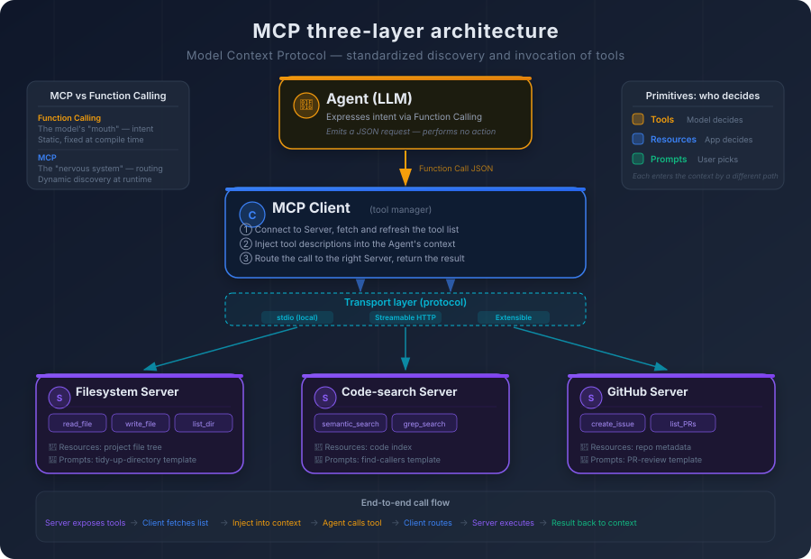
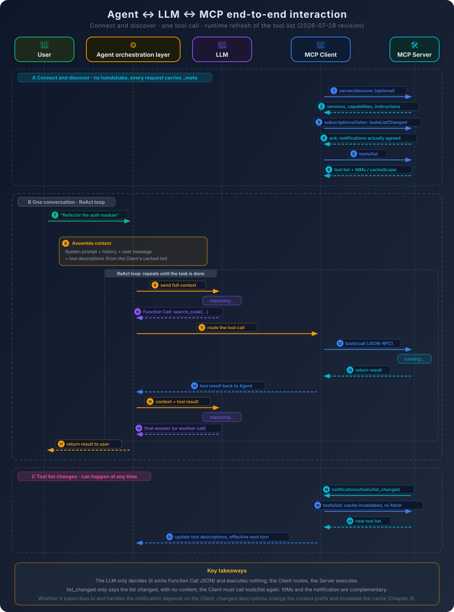
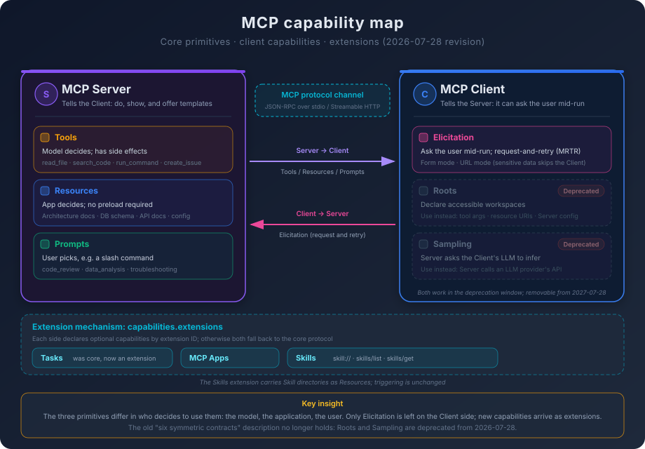

# 4. Standardizing Tool Use: How MCP Works

Suppose you build a database query tool. It connects to PostgreSQL, runs SQL, and returns formatted results. In your own AI coding setup it works smoothly: when the Agent needs to look at data, it calls the tool, reads the result, and continues.

Then you decide to share it with your team.

Your colleague A uses Cursor. B uses Copilot. C uses Codex. You open the docs of all three platforms and discover that each of them defines tools differently—different argument shapes, different registration mechanisms, different return-value structures, different error-handling conventions. To ship one tool, you end up writing three adapters. If a fourth platform shows up tomorrow, you write a fourth.

That situation should sound familiar.

If you lived through the early years of web development, you remember the browser-compatibility era. The same JavaScript had to be written one way for IE, another way for Firefox, and a third way for Safari. Web developers spent a huge fraction of their time on adaptation rather than development. The mess only ended when the web slowly converged on shared standards.

Before MCP, the AI tool-calling space sat in that earlier era. Every platform is reinventing its own wheel, and tool authors are forced to adapt to each wheel separately. This is not just an inconvenience. It is a structural barrier to the whole ecosystem.

## 4.1 The Cost of Fragmentation in Tool Integration

An Agent can only "do things" if it has tools to use. But integrating tools in a real engineering setting is much harder than it looks. This section describes the situation before standardization.

In the simplest case, tools are hardcoded into the Agent's system prompt. You write something like: *you may call the following functions: `read_file(path)`, `search_code(query)`, `run_command(cmd)`*. The model reads those descriptions and, when needed, emits a JSON-shaped call. Some external system parses the JSON, runs the operation, and returns the result.

That works fine when the tool surface is small and stable. The moment you face a real engineering environment, problems start stacking up.

**Tool count grows fast.** A serious AI coding setup needs file read/write, code search, terminal commands, Git operations, database queries, API calls, documentation lookup, test runners, linters, dependency managers, and so on. Add team-internal tools—wrappers around your private APIs, custom queries against business data, CI/CD triggers—and the number easily passes a hundred.

Stuffing a hundred tool descriptions into the system prompt is not free. At roughly a hundred tokens per tool, a hundred tools eat ten thousand tokens before the Agent has done anything useful. And asking the model to pick the right tool out of a hundred candidates noticeably degrades selection accuracy.

**Tools come from many different places.** Inside one team, tools rarely share an origin. Some are built into the IDE (file operations, terminal commands). Some wrap third-party services (GitHub, Jira). Some are written internally (knowledge-base lookups, business data queries). The authors are different, the maintenance cadences are different, the API styles are different. If every tool has to be wired into the Agent's configuration by hand, the maintenance cost grows linearly with the tool count.

**Cross-platform adaptation is a tax.** This is the most direct pain point. Each model provider's function-calling interface describes tools in its own format, and open-source Agent frameworks each invent their own variant. If you build something genuinely useful—say, a tool that analyzes code complexity—and you want every AI coding platform to be able to use it, you end up writing one adapter per platform. It is technically possible. It is just expensive and exhausting.

But the deeper problem is not "format mismatch."

**There is no standard way for an Agent to discover what tools exist.** The format question is the surface. The deeper question is: how does the Agent know which tools are available in the first place? In hardcoded mode, the answer is "the developer wrote them into a config file." But what if tools are dynamic? If a new tool provider comes online, can an Agent automatically pick it up? Without a standardized discovery mechanism, every new tool requires human work: edit a config, restart the Agent, verify the integration.

**There is no standard way to describe what a tool can do.** Different platforms describe tool capabilities in different shapes—natural language, JSON Schema, custom DSLs. The model's understanding of a tool comes entirely from those descriptions. If the description shape is inconsistent, the same tool can behave very differently across platforms.

**There is no standard permission model.** Tool calling is a security problem. A tool that can run shell commands has a permission boundary somewhere. Can it run `rm -rf /`? Who decides? Without a shared permission model, every platform implements its own policy, and tool authors cannot make consistent cross-platform safety guarantees.

If you have built microservices, this picture is familiar. Microservices went through the same era—every service shipping its own protocol, its own discovery mechanism, its own auth scheme. The ecosystem only matured once standards like gRPC, Consul, and OAuth converged on shared shapes.

AI tool calling needs the same kind of convergence. That is the starting point of MCP.

## 4.2 From Static Binding to Dynamic Discovery

To see what MCP is really solving, start from the limitations of plain Function Calling and let the design reasoning unroll.

In its most common usage, Function Calling is **static binding**: before the conversation starts, every available tool is already written into the configuration or system prompt. For the entire run, the model can use those tools and only those tools. It is the AI equivalent of static linking in a compiled language—every dependency is decided at build time, and runtime cannot change it.

Static binding works fine in simple cases. Once you face the following requirements, it begins to break.

**Different tasks need different tool sets.** When the Agent is writing code, it needs file operations and code search. When it is analyzing data, it needs database access and visualization. When it is managing a project, it needs Jira and GitHub APIs. If you cram every tool into the system prompt, most of those tools are useless most of the time—they consume context and increase the chance the model picks the wrong one.

**Tool providers and Agent developers are not the same people.** Suppose your team builds an internal knowledge-base lookup tool and wants every engineer's AI coding setup to use it. Under static binding, every engineer has to manually add the description to their config. The tool's API changes? Everyone updates again. The tool is retired? Everyone deletes the entry. The maintenance cost scales linearly with team size.

**The available tools change with the environment.** The project switches language, a new database gets connected, a service goes offline, and the usable tools should change with it. Under static binding, those changes mean someone edits the config and restarts the conversation.

What you actually want is **dynamic discovery**: at runtime, the Agent can find out what tools exist, fetch their descriptions, and call them on demand. This is the same intuition that drove service discovery in microservices. The consumer does not hardcode the provider's address; it asks a registry.

That is what MCP—the Model Context Protocol[1]—is for. It is service discovery and a wire protocol for AI tool calling, fused into one specification.

The core design goal is simple: **decouple the supply of tools from the use of tools**.

Tool providers expose their capabilities according to MCP—"here is what I can do, here is how to call me, here is the argument shape." Agents discover and invoke tools according to MCP—"here is what's available, here is how I send a request, here is how I read the result." Neither side needs to know the other's implementation. They only need to share the protocol.

MCP is to Agents what an API gateway is to microservices. It does not do the work itself. It defines how the work gets routed.

## 4.3 The Three-Layer Architecture: Server, Client, and Transport

MCP is organized around three roles: Server, Client, and Transport.

**The MCP Server is the tool provider.** Each Server exposes a set of tools, and each tool has a name, a description, and an argument schema. A Server can offer one tool or a group of related ones. A "filesystem Server" might expose `read_file`, `write_file`, and `list_directory`. A "GitHub Server" might expose `create_issue`, `list_pull_requests`, `get_commit_history`, and so on.

A Server's job is narrow: declare what it can do, then actually do it when called. It does not care who is calling, why they are calling, or what the result will be used for. It only needs to honor the protocol—expose its interface, accept requests, return results.

**The MCP Client lives on the Agent side.** It connects to one or more Servers, fetches tool listings, and forwards requests when the Agent decides to call a tool.

The Client is, in effect, a tool manager. It tracks which Servers are connected, which tools each Server offers, and what arguments each tool expects. When the Agent emits a Function Calling–shaped JSON to invoke a tool, the Client finds the right Server, packages the call according to the protocol, waits for the result, and hands it back to the Agent.

**The Transport is the wire.** It carries messages between Client and Server. MCP supports several transports:

- **stdio**: communication over standard input and output. The Server runs as a local process, and the Client exchanges messages with it through stdin/stdout. This is the simplest setup and fits local tools well.
- **Streamable HTTP**: communication over a single HTTP endpoint, optionally upgraded to a streaming response when needed. The Server can run on a remote machine, and the Client reaches it over the network. This is the right shape for remote tools and shared tools. Earlier versions of MCP split this into a normal HTTP request channel plus a separate SSE channel; later revisions merged them into one Streamable HTTP endpoint. The older split form is now listed as deprecated[2], and new Servers should use Streamable HTTP directly.

The transport layer is pluggable. The protocol does not bind itself to one wire format. The same Server can support stdio and HTTP simultaneously, and the same Client can connect to local and remote Servers in parallel.

Put the three roles into a real run and the whole process falls into three phases, drawn together in the figure below. Step numbers in the rest of the chapter refer to this figure. This book follows the 2026-07-28 revision of the specification[1]. It differs from earlier revisions in how a connection starts, and those differences are summarized at the end of this section.

**A. Connect and discover.** There is no handshake in this revision. Every request carries the protocol version, client information, and client capabilities in its `_meta`, and the Server accepts or rejects each request on its own; there is no session. A Server must implement `server/discover`, and a Client may call it first to learn which protocol versions and capabilities the Server supports, along with optional `instructions` written for the model (steps 1 and 2). If the versions do not match, the Server returns an error listing the versions it supports, and the Client picks one and retries. Next, the Client opens a notification stream with `subscriptions/listen`, saying it wants `toolsListChanged` (step 3), and the Server first replies with an acknowledgement stating which notifications it actually agreed to send (step 4). Finally the Client calls `tools/list` (step 5). The Server returns each tool's name, description, and argument schema, together with caching hints: `ttlMs` says how many milliseconds the list can be treated as fresh, and `cacheScope` says whether it may be shared across users and authorization contexts (step 6).

**B. One conversation, which is the ReAct loop from Chapter 3.** The user makes a request (step 7). The Agent's orchestration layer assembles the context: the system prompt, the conversation history, the user message, plus the tool descriptions cached by the Client. Everything the model knows about the tools comes from those descriptions (step 8). The full context goes to the LLM (step 9), and when the model decides to call a tool, it emits a Function Calling–shaped JSON (step 10). The LLM stops there; it executes nothing. The Agent hands that intent to the Client (step 11), the Client finds the right Server and sends a `tools/call` request (step 12), the Server runs the tool and returns the result (step 13), the result travels back through the Client to the Agent (step 14), gets folded into the context, and goes to the LLM again (step 15). The LLM either calls another tool or gives the final answer (step 16), and only when the task is done does the result reach the user (step 17).

**C. The tool list changes, which can happen at any time.** The first two phases are the routine of a connection. What makes it "dynamic" is the third. When the tool list changes, say the Server brings a new tool online or retires one, a Server that declared `listChanged` pushes a `notifications/tools/list_changed` over the stream opened in step 3, to Clients that subscribed to `toolsListChanged` (step 18). The notification only says "the list changed." It carries no content and does not say what was added or removed. The Client discards its cached list and calls `tools/list` again (steps 19 and 20), then updates the tool descriptions it gives the Agent, which take effect when the next turn assembles its context (step 21).

The notification and `ttlMs` are complementary. `ttlMs` tells the Client how long it need not ask again, and the notification invalidates the cache the moment the list changes. A Server can even supply only `ttlMs` and not declare `listChanged`, in which case the Client discovers changes purely through cache expiry.

A few boundaries of this mechanism are worth stating up front:

- The notification is a SHOULD in the specification, and it only goes to Clients that opened the stream and asked for `toolsListChanged`. A Client that did not subscribe can only re-fetch after `ttlMs` expires.
- The protocol provides the channel; whether it is used depends on the specific Client. A Client that neither subscribes nor honors the TTL keeps the list as it was at first fetch, and "dynamic" shrinks to "reconnect."
- The protocol does not decide which tools should exist under which conditions, and this revision adds a constraint: for the same request, the Server's tool set must not differ by connection; it may differ only by the authorization the request carries. So a requirement such as "show Python tools only when working on a Python project" has two real routes: the Client and the user decide which Servers to connect, or different authorizations see different tools.
- When the tool descriptions change, the context prefix changes with them, and the cache discussed in Chapter 9 is invalidated. The specification also recommends that Servers return tools in a deterministic order, partly so that LLM prompt caching hits more easily. Swapping tools often is not free.

If you are reading older material, the flow will look different. In revisions up to 2025-11-25, a connection began with an `initialize` call that negotiated the version and capabilities and established a session, and the list-changed notification travelled on that session, with no `subscriptions/listen` step and no `ttlMs` or `cacheScope`. Existing Clients and Servers do not upgrade overnight, so the new revision defines rules for each side to probe the other and fall back to the older handshake[1]. What stays the same across both is the core idea: discover tools, hand the descriptions to the model, let the model emit an intent, have the Client route it, have the Server execute it, and notify the Client to re-fetch when the tools change.

If you strip MCP down to its essence, it is a JSON-RPC protocol plus a tool description specification. JSON-RPC handles message format and delivery. The description specification handles "how do you tell an Agent what this tool can do." Think of it as the AI-era counterpart to OpenAPI Spec, and the mystique disappears. OpenAPI Spec defines how to describe a REST API; MCP defines how to describe an AI-callable tool. The difference is who reads the description: OpenAPI is read by human developers, MCP is read by a language model.

That difference looks small. It leads directly to the most underrated problem in the entire ecosystem.

## 4.4 The Art of Tool Description: The Model Only Knows What the Text Says

If an OpenAPI Spec is poorly written, a human developer can read the source code, ask a colleague, or just call the endpoint and inspect the response. If an MCP tool description is poorly written, the model has no recourse. Its entire understanding of the tool is whatever that description says.

This is the most often-overlooked, highest-impact issue in MCP design.

Recall what we said in Chapter 3 about Function Calling: the model does not "understand" what a tool does, it reads the description. Every word in that description shapes the model's decisions through the attention mechanism—when to call the tool, what to pass in, how to interpret the result.

Take a concrete example. Suppose you have a code-search tool. Compare two ways of describing it.

**Description A:**
> Name: `search_code`
> Description: searches code.

**Description B:**
> Name: `search_code`
> Description: performs semantic search over the source files of the current project. Given a natural-language query, returns the most relevant code snippets along with their file paths and line numbers. Use this when you need to understand the meaning of code (for example, "find the function that handles user authentication"). For exact text matching (such as locating every occurrence of a variable name), use the `grep_search` tool instead.

The same tool, the same protocol, two completely different agent behaviors.

With Description A, the model only knows that "this tool searches code." It does not know whether that means semantic search or text search, what the search scope is, or what the return format looks like. It may invoke the tool when exact matching is needed (the description does not say it cannot), or call it for documentation searches (the description does not say it only searches code).

With Description B, the model knows it is semantic search, that the scope is source files, that the return value contains paths and line numbers, and crucially when to use it and when to choose something else. The probability of a correct decision goes up sharply.

A few elements drive description quality.

**Name.** Concise and meaningful, so that the name alone hints at the purpose. `search_code` is better than `tool_1`. `semantic_code_search` is more precise than `search_code`.

**Functional description.** State what the tool does, when it applies, and—often more important—**when it does not apply**. The "does not apply" part is what helps the model pick correctly between similar tools.

**Argument schema.** Each argument's type, meaning, and constraints. Not just "`path: string`," but "`path: string`, the absolute path of a file, must be inside the project directory, glob patterns are not supported."

**Return-value description.** What the result looks like, what error states are possible. The model needs to know the structure to correctly read the output.

But there is a structural cost: **descriptions consume context**.

At one or two hundred tokens per tool, fifty tools easily eat five to ten thousand tokens before any work begins. The richer the description, the better the model's selection, but the smaller the budget left for the real task. This is a genuine engineering trade-off.

A common middle path is **layered description**. Put the essentials—name, one-line purpose, key arguments—in the tool description visible to the model at all times. Push detailed usage notes and examples into an extended document that is loaded only when the model explicitly needs more.

Description quality is the real bottleneck of the MCP ecosystem. The protocol can be elegant, the architecture can be clean, and the experience will still be poor if the descriptions are weak. It mirrors REST API design: HTTP is standardized, but if the API documentation is sloppy, no one can use the API well. MCP defines the format. It cannot enforce the quality. Quality depends on whether the tool author understands how a model reads text—and that understanding is exactly what most tool authors do not have yet.

## 4.5 MCP and Function Calling: Different Layers, Not Replacements

You may be wondering at this point: how does MCP relate to Function Calling? Is MCP replacing it?

It is not. They sit at different layers and solve different problems.

**Function calling solves: how does the model express the intent to use a tool?** It is a model-side capability. During generation, the model can emit a structured JSON payload that says "I want to call this tool." That capability comes from training and is part of the model itself. Without function calling, the model can only emit prose; it has no way to interact with anything outside the text channel.

**MCP solves: how do tools get discovered, described, and invoked?** It is a system-side protocol. It defines the wire format and conventions between tool providers and tool consumers. Without MCP, tools can still be invoked—through hardcoded wiring—but discovery, management, and cross-platform reuse have no shared shape.

The two are not competitors. They cooperate. Look back at the sequence diagram in section 4.3: function calling owns only step 10, where the model emits its intent, and it executes nothing itself. Discovery, description, routing, execution, and list refresh are all MCP's job. They divide the work cleanly across layers.

A more precise analogy: function calling is the model's **mouth**—it lets the model express what it wants to do. MCP is the **nervous system** between the model and the tools—it lets that intent reach the right tool and the result come back. The mouth and the nervous system are not competing for the same job.

Once you see this, a common misconception falls away. Some people say "MCP will replace Function Calling." That is wrong. MCP does not change how the model expresses intent—the model still emits structured JSON to request a tool. MCP changes how that request is processed: instead of being hardcoded into the Agent's configuration, it is routed dynamically through a standardized protocol.

There is one more difference worth pulling forward: **static binding versus dynamic discovery**.

With static binding, the tool list is fixed before the conversation starts. If you wrote five tools into the configuration, those are the only five tools that can be used during the entire run. Need a sixth mid-conversation? End the conversation, edit the config, start over.

In MCP, the tool list is fetched at connection time and can also be refreshed while running. When a Server's tools change, it pushes a `list_changed` notification, the Client invalidates its cache and re-fetches the list, and from the next turn the Agent can use the new tools, with no restart and no config edit. When a Server goes offline, the Client disconnects and removes its tools from the list. Section 4.3, phase C, has the details. This assumes the Client actually subscribed to and handles the notification: the protocol supplies the channel, and does not guarantee that every Client uses it.

That dynamism is MCP's central advantage over plain function calling. It decouples the lifecycle of tools from the lifecycle of Agents. Tools come, update, and go on their own schedule. The Agent does not have to change to keep up.

There is one more difference worth flagging now, because most introductions to MCP miss it: **function calling is one-way; MCP keeps a reverse channel**. In function calling, the model expresses intent and the outside world executes passively. In MCP, a Server can pause in the middle of handling a request and ask the user for information it lacks, which is called Elicitation. Earlier versions of MCP also designed more reverse capabilities, such as letting a Server borrow the Client's model for inference, but the latest version has taken those back. What the reverse channel kept and what it dropped is the subject of the next section.

## 4.6 The MCP Capability Map: From Tool Protocol to Context Protocol

So far we have talked about MCP's **Tools**. But MCP's surface is wider than that. If you only read the early write-ups about MCP, it is easy to think of it as "a standard for tool calling," and that view is now too narrow. Another popular description, that Server and Client exchange a symmetric set of contracts, no longer holds in the latest revision either, as we will see. MCP today has three parts: the three core primitives a Server exposes to the Client, the capabilities a Client exposes to the Server, and an extension mechanism that lets the protocol grow new capabilities.

Start with the Server side. A Server exposes three classic primitives, and the most useful way to tell them apart is **who decides to use it**:

| Primitive | What it is | Who decides | How it works |
| :--- | :--- | :--- | :--- |
| Tools | Executable operations with side effects | The model | The model emits a call intent, and the Client forwards it with `tools/call` |
| Resources | Readable data: files, database schemas, docs | The application | The Client discovers them with `resources/list`, the application decides which to bring into context, and `resources/read` fetches them |
| Prompts | Prompt templates with arguments | The user | The Client discovers them with `prompts/list`, the user explicitly picks one in the UI, and `prompts/get` returns the filled-in messages |

Each of the three has its own `list_changed` notification. You subscribe the same way as in phase C of section 4.3, declaring `promptsListChanged` or `resourcesListChanged` in `subscriptions/listen`.

**Tools** are what we have been discussing all along: mid-execution the model decides what it needs and emits a call, and the Server runs it and returns a result. `read_file`, `search_code`, and `run_command` are all Tools. They read external data, change external state, or trigger external actions.

**Resources** are decided by the application. The specification calls this application-driven: the application chooses which resources enter the context and how. It might let the user pick in the UI, offer search and filtering, or include them automatically by some rule; the specification mandates no single pattern. If you have a project architecture document that should stay available throughout the task, a Resource is the better fit, with the application bringing it into context when the task starts. As a `get_architecture_doc` tool, the model might forget to call it when needed, or call it repeatedly when not needed.

**Prompts** are decided by the user. The Server exposes templates with arguments, for example a `code_review` Prompt whose argument is the code to review. The user picks it in the Client's UI (the specification's own example is a slash command), the Client calls `prompts/get` with the arguments, the Server fills them into the template and returns a set of messages, and those messages enter the conversation for the model to continue from. It is not "experience" the Agent reads on its own. It is the user deliberately opening a conversation with a template.

Both Resources and Prompts need the Client to provide a matching interface: one for the user to pick resources, one for the user to pick templates. Support varies across clients, so check that yours supports them before relying on them.

Resources and Prompts both carry text, and both guide the model on how to work, which makes them easy to confuse with the Skills of Chapter 5. They differ in who triggers them, what carries them, and what they can bring:

| | MCP Prompts | MCP Resources | Skill |
| :--- | :--- | :--- | :--- |
| Who triggers it | The user, explicitly | The application | The model, from the summary |
| Carrier | Messages the Server returns over the protocol | Content the Server returns over the protocol | Usually a directory: `SKILL.md`, references, scripts; it can live locally, or a Server can provide it as resources through the Skills extension |
| How it loads | Fetched whole when picked | Read whole when selected | Summary always present, body expanded on demand |
| What it can carry | A set of messages, which can embed resources | Text or binary content | Instructions, references, workflow, executable scripts |

Take code review. As a Prompt, the user types a command and a review template goes into the conversation together with the code to review. As a Resource, the application attaches the team's review standard to the context as reference material. As a Skill, the Agent sees a PR, decides on its own to load the review process, and brings along the checklist, examples, and check scripts. In the first two, the trigger is not in the model's hands. The Skill hands the trigger to the model and can carry scripts too. That is what the next chapter is about: making a capability come to mind at the right moment, without waiting for someone to click.

Skills and MCP now overlap. MCP has an official Skills extension[3] in which a Server exposes every file in a Skill directory as a Resource, addressed with `skill://`, listed and fetched with `skills/list` and `skills/get`, and the format itself follows the Agent Skills standard. This uses Resources to transport Skills; it does not change how each is triggered. Reading `SKILL.md` through `resources/read` only retrieves bytes, and it counts as loading only once the host's own Skill-loading path processes it. The extension has reached Final status, and host and SDK support is still being built out. One distinction to keep: the "reference resources" a Skill points to are files in the Skill's directory, referenced by the Skill itself. They are not the same thing as the Resources a Server exposes and the application selects.

Now the Client side. The protocol once designed a set of symmetric reverse capabilities: Roots, Sampling, and Elicitation. In the 2026-07-28 revision, that changed.

**Elicitation (asking the user mid-run)** stayed. While handling a request, a Server may find it lacks a piece of information. A deployment Server reaching "should this overwrite the production config?" does not return a result. It returns an intermediate "more input needed" result that carries the question for the user. The Client puts the question in front of the user, and once it has the answer, it re-sends the original request with the answer attached, and the Server continues from there. The new revision turns this into a request-and-retry pattern rather than a Server-initiated request to the Client; the mechanism is called multi round-trip requests (MRTR). Questions come in two forms: form mode collects structured, non-sensitive data, and URL mode sends the user to a browser for passwords, API keys, and third-party authorization, so that data never passes through the Client. This breaks out of the binary "either gather every argument up front or just default and run," giving humans a real-time decision point inside the Server's execution.

**Roots and Sampling** were taken back. Roots let a Client tell a Server which workspaces it may access, and Sampling let a Server turn around and ask the Client's model for an inference. Both are listed as deprecated from the 2026-07-28 revision[2]: they still work during the deprecation window, but new implementations should not adopt them, and the earliest they can be removed is in a specification version released on or after 2027-07-28. The official replacements are plain: pass directories and files through tool arguments, resource URIs, or Server configuration; and a Server that needs model inference calls an LLM provider's API directly.

That is worth keeping in mind when you read MCP material: a capability is not settled just because it was written into the specification. The popular description of "Roots, Sampling, and Elicitation as a symmetric contract" holds today only for Elicitation.

**The extension mechanism.** The new revision adds an `extensions` field to capability declarations, where each side declares which optional capabilities it supports by extension identifier; if the other side does not, both fall back to core protocol behavior. Extensions that have appeared include Tasks (formerly in the core protocol, now moved out as an extension), MCP Apps, and the Skills extension mentioned above.

The direction of that change reflects a steadier recognition: **what an Agent needs is not just "tools."** It also needs context, templates, human decision points, and distributable capability packages wired in, but the way they are wired in depends on which contracts actually hold up in practice. Through this evolution, MCP has moved from a tool-calling protocol toward something closer to a unified protocol for context, tools, and workflows, while also taking back the designs that did not settle.

## 4.7 What MCP Solves, and What It Does Not

MCP is an elegant protocol design. It is not a silver bullet. Before closing the chapter, it is worth being honest about both.

**What MCP solves.**

First, **standardized tool discovery and invocation**. With MCP in place, a tool author exposes a capability through one shared protocol and is automatically reachable by every MCP-aware Agent. No per-platform adapter. No need to understand each Agent's internals. The cost of building and maintaining tools drops sharply.

Second, **decoupling between tool providers and tool consumers**. Tools can be developed, deployed, and updated independently of any Agent. A team can run a set of MCP Servers, and every team member's AI coding setup picks up the tools automatically. Tool API changes? Once the Server updates, a Client gets the new description when its cache expires, or when it re-fetches after a `list_changed` notification.

Third, **cross-platform tool reuse**. One MCP Server is usable from Cursor, Copilot, Codex, or any other MCP-aware platform. Tool authors write once, run everywhere. That matters because a healthy tool ecosystem only forms when the engineering investment in a tool can be amortized broadly enough to justify it.

**What MCP does not solve.**

**Tool description quality.** MCP defines the format of the description; it cannot enforce that the description is good. A tool described as "searches code" and a tool described as "performs semantic search over the source files of the current project, suitable when you need to understand the meaning of code" are both valid MCP entries. The first will cause the Agent to misuse the tool repeatedly. The second will let the Agent decide well. The protocol does not replace engineering judgment.

**Tool-call security.** Who is allowed to call which tools? Should an Agent be allowed to run `rm -rf /` through a shell tool? At the protocol level, MCP provides an OAuth-style authorization model that constrains how access tokens to remote Servers can be reused, and the new revision further requires that a Client's registration credentials be bound to the authorization server that issued them. Roots, which once declared workspace boundaries, is now deprecated, and boundaries are expressed through tool arguments, resource URIs, or Server configuration instead[2]. But that only solves "the protocol leaves room for safety." **Real-world permission control, audit logs, and human-in-the-loop confirmation steps still have to be built on top of MCP**. The protocol defines the mechanism. It does not define the policy. This topic is important enough that we save it for Chapter 12.

**Tool-call performance.** Every call has protocol overhead—Client/Server messaging latency, JSON-RPC serialization, transport delivery. For local stdio communication that overhead is negligible. For remote HTTP communication, each call can add tens to hundreds of milliseconds. Across a task that takes twenty tool calls, the accumulated latency is real.

**Coordination across multiple tools.** MCP defines how a single tool gets called. It does not define how multiple tools coordinate. If a task needs tool A to fetch data, then tool B to operate on that data, who owns that coordination logic? The dominant answer is still "the Agent owns it"—the model uses a ReAct loop to sequence the tool calls. Sampling was once seen as another route: let a Server borrow the Client's model to organize a stretch of multi-step reasoning inside the Server. But it is deprecated from the 2026-07-28 revision, and the official advice is that a Server needing inference should call an LLM provider's API directly[2]. That means the protocol leaves no path for a Server to borrow the Client's model for orchestration. Complex multi-tool coordination is carried either by the Agent's ReAct loop or by a Server that holds a model of its own.

**Agent-to-Agent interoperability.** MCP solves "an Agent reaches outward to use tools." But a tool is not an Agent. The moment you want one Agent to invoke another independent Agent—say, a coding Agent handing a critical change to an independent security-review Agent—MCP's abstractions stop fitting. Tools are deterministic (reading a file is reading a file). Agents are non-deterministic ("review this code for me" yields different results every time). You can wrap an Agent as if it were an MCP Tool, and on the surface it will run, but you lose the parts that matter most between Agents: identity discovery, task lifecycle, state sync, and mid-run follow-up questions. That layer—a protocol *between* Agents—is something MCP does not aim to solve, and should not solve. We come back to it in Chapter 6 when we discuss multi-Agent collaboration.

**Ecosystem depth.** A standardized protocol is only as valuable as the ecosystem around it. If only a handful of MCP Servers exist, you still end up writing most of the tools yourself, and the protocol itself does not buy you much. MCP's long-term value depends on a thriving population of high-quality Servers covering enough real-world scenarios. This space moves quickly, and any specific snapshot of it dates fast. The underlying logic does not change, though: standardization lowers the cost of building tools, lower cost attracts more authors, more authors produce more tools, more tools attract more users. That is a positive feedback loop.

That feedback loop is now starting to spin. MCP marketplaces are emerging in roughly the role App Store played for iOS and npm played for Node.js. Smithery, mcp.run, and the MCP Server catalogs built into Cursor and Windsurf are turning tool distribution from "write a Server, configure your client to connect" into "browse the store, install with one click." You want your Agent to query Jira? You no longer write a Server—you search the store, install, and the Client connects automatically. The next conversation, the Agent has the capability.

That sharply lowers the cost of *adopting* tools. But notice what the marketplace solves and does not solve. It solves distribution. It does not solve quality. The Servers in these stores vary widely—some have precise descriptions, sensible argument shapes, and proper error handling; others are vague, miss edge cases, and have weak security posture. Installing a Server means granting the Agent a new capability, and the boundary of that capability depends on the engineering discipline of whoever wrote the Server. It is the same situation as installing an npm package: convenience does not relieve you of the need to judge whether the package is trustworthy and appropriate for your context.

---

MCP solves how tools get standardized, discovered, and invoked. That is a foundational layer for the Agent ecosystem. But MCP only answers the question of *where tools come from*, and what an Agent needs is not just tools.

A coding convention is not a function call. An architectural pattern is not an API request. A code-review checklist is not an executable operation. They are bundles—a collection of instructions, resources, and workflow that say "in this kind of situation, follow these rules, consult these documents, and proceed in this order." MCP's Prompts primitive points in that direction, but it is designed for a user to pick a template explicitly. It has no mechanism for the model to decide when to load it, and it carries no executable scripts or structured workflow. MCP's own later answer is a Skills extension, which uses Resources to carry a capability-package format that stands on its own. When what you need to package is that whole bundle of instructions, reference material, conditional logic, and sub-task structure, you need an abstraction that is not "tool calling," and that is the subject of the next chapter.

## References

- [1] Model Context Protocol. *Specification (2026-07-28)*. <https://modelcontextprotocol.io/specification/2026-07-28>
- [2] Model Context Protocol. *Deprecated Features (2026-07-28)*. <https://modelcontextprotocol.io/specification/2026-07-28/deprecated>
- [3] Model Context Protocol. *SEP-2640: Skills Extension*. <https://modelcontextprotocol.io/seps/2640-skills-extension>

Access date for the official specification is November 2026; the specification version may have been updated since. Revisions up to 2025-11-25 use the `initialize` handshake, which differs from the connection flow this chapter describes for 2026-07-28.
